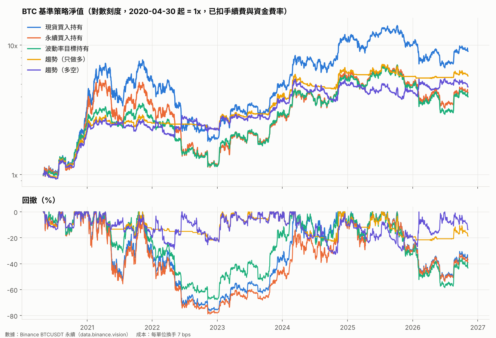

# BTC 基準策略回測

- 期間：2020-04-30 ~ 2026-11-07（日線，UTC 收盤）
- 成本：每單位換手 7 bps（taker 手續費 5 bps + 滑價 2 bps），並扣除永續合約資金費率
- 波動率目標 40%／年，槓桿上限 1.5 倍；趨勢 = 20／60／120 日報酬正負號平均
- 參數都是常見預設值，沒有用歷史數據調整過

## 全期間

| 策略      | 年化報酬   | 年化波動   |   夏普值 |   索提諾 | 最大回撤   |   卡瑪比 | 平均曝險   | 年換手   | 成本拖累/年   |
|:--------|:-------|:-------|------:|------:|:-------|------:|:-------|:------|:---------|
| 現貨買入持有  | +39.9% | 56.9%  |  0.87 |  1.25 | -76.7% |  0.52 | 1.00x  | 0.0x  | +0.0%    |
| 永續買入持有  | +25.0% | 56.8%  |  0.68 |  0.97 | -78.9% |  0.32 | 1.00x  | 0.0x  | +11.3%   |
| 波動率目標持有 | +23.6% | 43.0%  |  0.71 |  1.02 | -67.7% |  0.35 | 0.83x  | 5.7x  | +8.5%    |
| 趨勢（只做多） | +30.8% | 25.8%  |  1.17 |  1.4  | -23.2% |  1.33 | 0.34x  | 21.3x | +6.9%    |
| 趨勢（多空）  | +27.0% | 33.3%  |  0.88 |  1.28 | -32.8% |  0.82 | 0.56x  | 39.9x | +7.4%    |

## 2020–2022

| 策略      | 年化報酬   | 年化波動   |   夏普值 |   索提諾 | 最大回撤   |   卡瑪比 | 平均曝險   | 年換手   | 成本拖累/年   |
|:--------|:-------|:-------|------:|------:|:-------|------:|:-------|:------|:---------|
| 現貨買入持有  | +26.7% | 69.4%  |  0.69 |  0.97 | -76.7% |  0.35 | 1.00x  | 0.0x  | +0.0%    |
| 永續買入持有  | +6.6%  | 69.4%  |  0.44 |  0.62 | -78.9% |  0.08 | 1.00x  | 0.0x  | +17.3%   |
| 波動率目標持有 | +5.5%  | 43.1%  |  0.34 |  0.46 | -67.7% |  0.08 | 0.65x  | 4.8x  | +10.4%   |
| 趨勢（只做多） | +35.7% | 26.0%  |  1.3  |  1.53 | -21.7% |  1.64 | 0.24x  | 13.6x | +8.2%    |
| 趨勢（多空）  | +36.2% | 34.6%  |  1.06 |  1.55 | -28.8% |  1.25 | 0.44x  | 31.5x | +8.7%    |

## 2023 至今

| 策略      | 年化報酬   | 年化波動   |   夏普值 |   索提諾 | 最大回撤   |   卡瑪比 | 平均曝險   | 年換手   | 成本拖累/年   |
|:--------|:-------|:-------|------:|------:|:-------|------:|:-------|:------|:---------|
| 現貨買入持有  | +49.9% | 46.2%  |  1.11 |  1.71 | -53.0% |  0.94 | 1.00x  | 0.0x  | +0.0%    |
| 永續買入持有  | +39.6% | 46.2%  |  0.95 |  1.47 | -53.7% |  0.74 | 1.00x  | 0.0x  | +7.1%    |
| 波動率目標持有 | +38.0% | 42.9%  |  0.96 |  1.47 | -58.5% |  0.65 | 0.95x  | 6.3x  | +7.1%    |
| 趨勢（只做多） | +27.6% | 25.7%  |  1.07 |  1.3  | -23.2% |  1.19 | 0.41x  | 26.6x | +6.0%    |
| 趨勢（多空）  | +21.0% | 32.4%  |  0.75 |  1.08 | -32.8% |  0.64 | 0.64x  | 45.7x | +6.5%    |

## 參數敏感度：趨勢（只做多）

不同回看週期、不同成本假設下的結果。數字差不多，才代表效果不是剛好挑到好參數。

| 回看週期（日）    |   夏普（7bps） | 最大回撤（7bps）   |   夏普（20bps） | 最大回撤（20bps）   |
|:-----------|-----------:|:-------------|------------:|:--------------|
| 10/30/60   |       1.09 | -28.7%       |        0.95 | -30.4%        |
| 20/60/120  |       1.17 | -23.2%       |        1.06 | -25.1%        |
| 30/90/180  |       1.13 | -26.5%       |        1.05 | -28.4%        |
| 50/100/200 |       0.67 | -43.5%       |        0.59 | -46.3%        |
| 60         |       0.88 | -51.9%       |        0.81 | -53.1%        |
| 120        |       0.9  | -38.2%       |        0.85 | -39.1%        |
| 200        |       0.7  | -54.5%       |        0.66 | -56.7%        |

## 各年度報酬

|          | 現貨買入持有   | 永續買入持有   | 波動率目標持有   | 趨勢（只做多）   | 趨勢（多空）   |
|:---------|:---------|:---------|:----------|:----------|:---------|
| 2020     | +229.6%  | +193.9%  | +148.5%   | +124.2%   | +112.4%  |
| 2021     | +59.6%   | +17.6%   | +9.5%     | +11.4%    | +4.5%    |
| 2022     | -64.2%   | -65.7%   | -57.6%    | -9.5%     | +2.8%    |
| 2023     | +155.9%  | +136.5%  | +149.1%   | +75.3%    | +59.9%   |
| 2024     | +121.1%  | +96.2%   | +85.0%    | +53.2%    | +33.7%   |
| 2025     | -6.4%    | -11.0%   | -11.1%    | -5.7%     | -9.2%    |
| 2026（至今） | -10.2%   | -12.5%   | -15.6%    | +0.9%     | +7.3%    |
