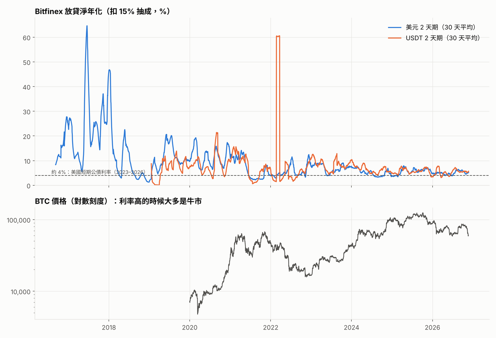

# Bitfinex 放貸報酬研究

數據：Bitfinex 公開 API 每日放貸成交利率（收盤），扣除 15% 平台抽成。假設資金 100% 借得出去，實際會有閒置，所以這是偏樂觀的上限。

## 各年度平均淨年化

|   年度（扣 15% 抽成後的平均年化） | 美元 2 天期   | 美元 30 天期   | USDT 2 天期   | USDT 30 天期   |
|---------------------:|:----------|:-----------|:------------|:-------------|
|                 2016 | 16.3%     | 15.0%      | —           | —            |
|                 2017 | 25.4%     | 25.7%      | —           | —            |
|                 2018 | 8.0%      | 8.9%       | 20.8%       | 20.5%        |
|                 2019 | 11.1%     | 11.5%      | 6.7%        | 8.1%         |
|                 2020 | 11.5%     | 12.7%      | 8.4%        | 9.1%         |
|                 2021 | 6.6%      | 8.8%       | 7.5%        | 10.7%        |
|                 2022 | 5.8%      | 10.9%      | 9.6%        | 14.7%        |
|                 2023 | 7.0%      | 14.5%      | 8.4%        | 11.2%        |
|                 2024 | 5.0%      | 8.4%       | 6.2%        | 9.2%         |
|                 2025 | 5.7%      | 8.6%       | 5.7%        | 8.6%         |
|                 2026 | 5.0%      | 7.6%       | 5.4%        | 6.3%         |

## 分布與近期

| 幣別         | 期間        | 平均    | 中位數   | 低於 4% 的天數   | 高於 10% 的天數   | 高於 20% 的天數   | 最近 30 天平均   | 最近 90 天平均   |
|:-----------|:----------|:------|:------|:------------|:-------------|:-------------|:------------|:------------|
| 美元 2 天期    | 2016-07 起 | 9.4%  | 6.2%  | 25%         | 29%          | 10%          | 5.2%        | 5.3%        |
| 美元 30 天期   | 2016-07 起 | 11.9% | 9.3%  | 10%         | 44%          | 14%          | 6.6%        | 6.8%        |
| USDT 2 天期  | 2018-12 起 | 7.3%  | 5.6%  | 21%         | 13%          | 2%           | 5.7%        | 5.6%        |
| USDT 30 天期 | 2018-12 起 | 9.7%  | 7.6%  | 10%         | 22%          | 3%           | 6.6%        | 6.8%        |

## 和 BTC 趨勢策略對照

趨勢策略空手時，放貸利率通常也比較低（借錢做多的人少）。

| BTC 趨勢 v2   | 天數比例   | 美元放貸淨年化   | USDT 放貸淨年化   |
|:------------|:-------|:----------|:-------------|
| 有持倉（偏多頭）    | 55%    | 7.2%      | 7.3%         |
| 空手（偏空頭／盤整）  | 45%    | 6.1%      | 7.4%         |
