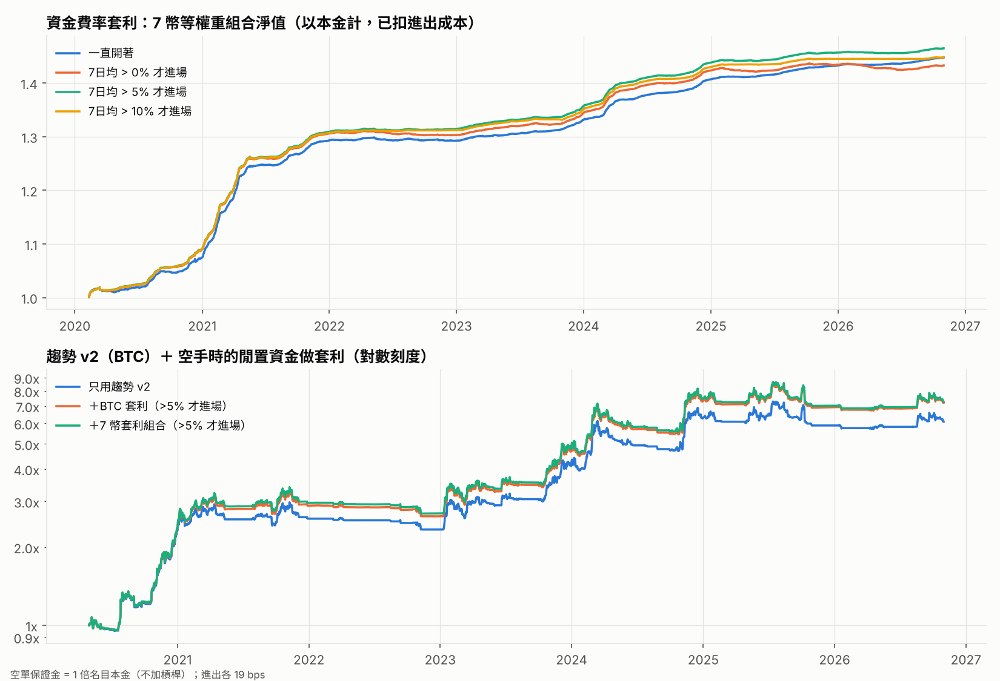

# 資金費率套利（現貨多 ＋ 永續空）

- 本金需求：現貨 1 ＋ 空單保證金 1 = 2 倍名目本金；報酬都以本金計
- 進場或出場各 19 bps（現貨 12 ＋ 永續 7）；兩邊部位每日再平衡的成本未計
- 「7日均 > x% 才進場」：過去 7 天平均資金費率（年化）超過 x% 才進場，跌破 0 就出場；門檻事先定好，沒有最佳化
- 資金費率只有月檔，所以最新一個月還沒有數據

## 1. 各幣種的資金費率與價差特性

| 幣種   | 價差單日最差   | 價差單日最好   | 永續溢價中位數   | 資金費率為負的天數   | 年化資金費率（平均）   |
|:-----|:---------|:---------|:----------|:------------|:-------------|
| BTC  | -0.69%   | +0.47%   | -0.039%   | 12%         | +11.6%       |
| ETH  | -1.36%   | +0.63%   | -0.038%   | 12%         | +13.7%       |
| XRP  | -6.59%   | +6.12%   | -0.040%   | 19%         | +14.4%       |
| BNB  | -1.01%   | +1.20%   | +0.000%   | 33%         | -0.1%        |
| LTC  | -0.75%   | +0.41%   | -0.039%   | 12%         | +14.7%       |
| LINK | -0.49%   | +0.44%   | -0.031%   | 11%         | +13.6%       |
| ADA  | -0.39%   | +0.41%   | -0.036%   | 19%         | +13.4%       |

## 2. 7 幣等權重組合

| 組合（7 幣等權重）    | 年化報酬（本金）   | 年化波動   |   夏普值 | 最大回撤   | 期間                |
|:--------------|:-----------|:-------|------:|:-------|:------------------|
| 一直開著          | +5.7%      | 0.8%   |  6.73 | -0.9%  | 2020-02 ~ 2026-10 |
| 7日均 > 0% 才進場  | +5.5%      | 0.8%   |  6.91 | -0.9%  | 2020-02 ~ 2026-10 |
| 7日均 > 5% 才進場  | +5.8%      | 0.8%   |  7.48 | -0.6%  | 2020-02 ~ 2026-10 |
| 7日均 > 10% 才進場 | +5.7%      | 0.8%   |  7.3  | -0.6%  | 2020-02 ~ 2026-10 |

各年度報酬（資金費率跟多空行情有關，牛市高、熊市低）：

|   年度（7 幣組合） | 一直開著   | 7日均 > 0% 才進場   | 7日均 > 5% 才進場   | 7日均 > 10% 才進場   |
|------------:|:-------|:---------------|:---------------|:----------------|
|        2020 | +7.5%  | +8.9%          | +9.1%          | +9.0%           |
|        2021 | +20.3% | +19.9%         | +20.0%         | +19.9%          |
|        2022 | -0.0%  | -0.2%          | +0.4%          | +0.4%           |
|        2023 | +3.0%  | +3.2%          | +3.2%          | +2.9%           |
|        2024 | +5.7%  | +5.9%          | +6.0%          | +5.8%           |
|        2025 | +1.9%  | +0.8%          | +1.3%          | +1.1%           |
|        2026 | +1.0%  | -0.1%          | +0.6%          | +0.2%           |

## 3. 趨勢 v2 ＋ 閒置資金做套利

趨勢策略沒用到的資金（1 − 倉位，倉位超過 1 倍時為 0）拿去做套利。

| 策略                            | 年化報酬（本金）   | 年化波動   |   夏普值 | 最大回撤   | 持有時間   | 閒置資金比例   |
|:------------------------------|:-----------|:-------|------:|:-------|:-------|:---------|
| 只用趨勢 v2（BTC）                  | +32.0%     | 26.1%  |  1.19 | -23.3% | 34%    | —        |
| 趨勢 v2 ＋ 閒置資金做BTC 套利（>5% 才進場）  | +35.4%     | 26.1%  |  1.29 | -22.3% | 34%    | 67%      |
| 趨勢 v2 ＋ 閒置資金做7 幣套利組合（>5% 才進場） | +35.6%     | 26.1%  |  1.3  | -22.3% | 34%    | 67%      |

|   年度 | 只用趨勢 v2   | ＋BTC 套利（>5% 才進場）   | ＋7 幣套利組合（>5% 才進場）   | 套利多賺   |
|-----:|:----------|:-------------------|:--------------------|:-------|
| 2020 | +130.9%   | +135.2%            | +136.6%             | +5.7%  |
| 2021 | +11.5%    | +22.8%             | +25.0%              | +13.5% |
| 2022 | -9.2%     | -8.9%              | -8.9%               | +0.3%  |
| 2023 | +75.7%    | +77.6%             | +77.0%              | +1.3%  |
| 2024 | +52.7%    | +56.1%             | +56.0%              | +3.3%  |
| 2025 | -6.2%     | -5.1%              | -5.9%               | +0.3%  |
| 2026 | +3.4%     | +4.0%              | +3.6%               | +0.2%  |

## 4. 各幣種明細

| 幣種   | 策略            | 年化報酬（本金）   | 年化波動   |   夏普值 | 最大回撤   | 持有時間   | 資金費率貢獻/年   | 價差貢獻/年   |
|:-----|:--------------|:-----------|:-------|------:|:-------|:-------|:-----------|:---------|
| BTC  | 一直開著          | +5.9%      | 0.7%   |  8.55 | -1.2%  | 100%   | +5.8%      | -0.1%    |
| BTC  | 7日均 > 0% 才進場  | +5.2%      | 0.7%   |  6.93 | -1.1%  | 90%    | +5.9%      | -0.0%    |
| BTC  | 7日均 > 5% 才進場  | +5.4%      | 0.7%   |  7.64 | -0.7%  | 81%    | +5.8%      | -0.0%    |
| BTC  | 7日均 > 10% 才進場 | +5.0%      | 0.7%   |  7.13 | -0.7%  | 58%    | +5.2%      | -0.0%    |
| ETH  | 一直開著          | +6.9%      | 0.9%   |  7.51 | -0.9%  | 100%   | +6.9%      | -0.1%    |
| ETH  | 7日均 > 0% 才進場  | +6.3%      | 0.9%   |  6.62 | -1.0%  | 90%    | +7.0%      | -0.1%    |
| ETH  | 7日均 > 5% 才進場  | +6.3%      | 0.9%   |  6.77 | -1.0%  | 81%    | +6.8%      | -0.1%    |
| ETH  | 7日均 > 10% 才進場 | +6.1%      | 0.9%   |  6.66 | -0.9%  | 58%    | +6.3%      | -0.1%    |
| XRP  | 一直開著          | +7.2%      | 2.0%   |  3.43 | -3.8%  | 100%   | +7.2%      | -0.2%    |
| XRP  | 7日均 > 0% 才進場  | +6.5%      | 1.5%   |  4.13 | -3.1%  | 81%    | +7.3%      | +0.4%    |
| XRP  | 7日均 > 5% 才進場  | +7.4%      | 1.5%   |  4.84 | -0.8%  | 72%    | +7.3%      | +0.4%    |
| XRP  | 7日均 > 10% 才進場 | +7.3%      | 1.5%   |  4.79 | -0.9%  | 63%    | +7.0%      | +0.4%    |
| BNB  | 一直開著          | -0.1%      | 1.3%   | -0.1  | -14.4% | 100%   | -0.1%      | -0.1%    |
| BNB  | 7日均 > 0% 才進場  | +2.7%      | 1.0%   |  2.76 | -2.3%  | 49%    | +3.6%      | +0.2%    |
| BNB  | 7日均 > 5% 才進場  | +3.0%      | 0.9%   |  3.18 | -1.5%  | 36%    | +3.5%      | +0.1%    |
| BNB  | 7日均 > 10% 才進場 | +3.0%      | 0.9%   |  3.26 | -1.0%  | 23%    | +3.3%      | +0.1%    |
| LTC  | 一直開著          | +7.4%      | 1.0%   |  7.53 | -0.6%  | 100%   | +7.3%      | -0.1%    |
| LTC  | 7日均 > 0% 才進場  | +6.6%      | 1.0%   |  6.54 | -1.8%  | 93%    | +7.3%      | -0.1%    |
| LTC  | 7日均 > 5% 才進場  | +6.9%      | 1.0%   |  7.02 | -0.7%  | 85%    | +7.2%      | -0.1%    |
| LTC  | 7日均 > 10% 才進場 | +6.7%      | 0.9%   |  6.95 | -0.7%  | 67%    | +6.8%      | -0.1%    |
| LINK | 一直開著          | +6.9%      | 1.1%   |  6.01 | -2.9%  | 100%   | +6.8%      | -0.0%    |
| LINK | 7日均 > 0% 才進場  | +6.6%      | 1.0%   |  6.22 | -1.1%  | 91%    | +7.3%      | -0.0%    |
| LINK | 7日均 > 5% 才進場  | +6.7%      | 1.0%   |  6.39 | -0.8%  | 87%    | +7.1%      | -0.1%    |
| LINK | 7日均 > 10% 才進場 | +6.4%      | 1.0%   |  6.35 | -0.5%  | 68%    | +6.7%      | -0.0%    |
| ADA  | 一直開著          | +6.8%      | 1.1%   |  6.02 | -1.0%  | 100%   | +6.7%      | -0.1%    |
| ADA  | 7日均 > 0% 才進場  | +5.7%      | 1.1%   |  5.08 | -2.3%  | 81%    | +6.9%      | -0.0%    |
| ADA  | 7日均 > 5% 才進場  | +6.2%      | 1.0%   |  5.85 | -1.0%  | 73%    | +6.8%      | -0.0%    |
| ADA  | 7日均 > 10% 才進場 | +6.4%      | 1.0%   |  6.17 | -0.4%  | 60%    | +6.6%      | -0.0%    |

## 風險（回測看不到的）

- **交易所風險**：現貨和合約都放在同一家交易所，交易所出事（例如 2022 年 FTX）會同時損失兩邊。
- **空單被強平**：價格急漲時空單保證金不足會被強平，套利就變成單邊做多。需要每天把現貨利潤轉去補保證金。
- **資金費率長期轉負**：熊市時空頭要付錢；遲滯規則會出場，但出場前仍會虧一段。
- **容量**：小資金沒問題；大資金進出會推動價差。
