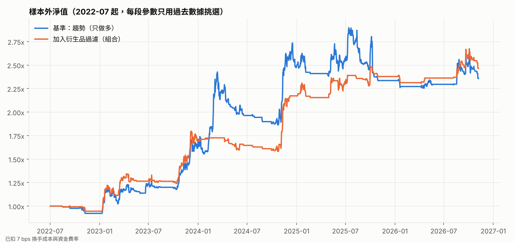

# 第三步：衍生品指標過濾

基準 = 趨勢（只做多，20/60/120 日 + 波動率目標 40%）。每個過濾條件在指標過熱時把倉位乘以 0 或 0.5。

## 1. 初步檢查：各指標分 5 組後，之後 7 天的平均報酬

Q1 = 指標最低的 20% 天數，Q5 = 最高的 20%。全樣本平均 7 日報酬 +1.01%。注意：7 日報酬彼此重疊，這張表只能看方向，不能當顯著性。

| 指標                 | Q1     | Q2     | Q3     | Q4     | Q5     | Q5 上漲機率   |   樣本天數 |
|:-------------------|:-------|:-------|:-------|:-------|:-------|:----------|-------:|
| 資金費率 z 分數（30 日）    | +1.65% | +0.63% | +0.80% | +0.76% | +0.89% | 54%       |   2465 |
| 資金費率 7 日均（年化）      | +1.74% | +0.25% | +0.20% | +1.73% | +1.00% | 55%       |   2488 |
| 持倉量 7 日變化          | +1.14% | +1.49% | +1.19% | +0.55% | +0.37% | 50%       |   2243 |
| 持倉量水位 z 分數（90 日）   | +1.38% | +2.73% | +1.05% | -0.37% | -0.88% | 41%       |   2158 |
| 散戶多空帳戶比 z 分數（90 日） | +1.29% | +1.45% | +0.77% | +0.64% | +0.08% | 49%       |   2050 |
| 大戶持倉多空比 z 分數（90 日） | +1.02% | +1.19% | +0.57% | +1.56% | +1.20% | 54%       |   1721 |
| 主動買入比 z 分數         | +1.58% | +0.67% | +1.05% | +0.19% | +1.21% | 50%       |   2456 |
| ETF 7 日淨流入（百萬美元）   | -0.72% | +0.90% | +0.61% | +1.52% | +0.92% | 52%       |   1016 |
| （對照）價格 7 日漲跌       | +0.89% | +1.01% | +0.43% | +0.40% | +2.18% | 58%       |   2487 |

## 2. 滾動前推（樣本外）結果

每 6 個月一段，只用之前的數據挑參數；需比「不使用」夏普高 0.05 以上才採用。「勝過基準機率」是以 20 天區塊重抽 2000 次，過濾後夏普值高於基準的比例；**低於 90% 都不能算可靠的改善**。

| 過濾條件          | 樣本外期間             |   基準夏普 |   過濾後夏普 | 基準回撤   | 過濾後回撤   | 基準年化   | 過濾後年化   | 採用段數   | 勝過基準機率   | 平均曝險            |
|:--------------|:------------------|-------:|--------:|:-------|:--------|:-------|:--------|:-------|:---------|:----------------|
| 資金費率過熱        | 2022-07 ~ 2026-11 |   0.93 |    0.93 | -23.2% | -23.2%  | +21.8% | +21.8%  | 0/9    | 相同       | 0.37x（基準 0.37x） |
| 資金費率絕對水位      | 2022-07 ~ 2026-11 |   0.93 |    0.81 | -23.2% | -22.3%  | +21.8% | +17.0%  | 9/9    | 27%      | 0.35x（基準 0.37x） |
| 持倉量水位偏高       | 2022-07 ~ 2026-11 |   0.93 |    1.05 | -23.2% | -17.8%  | +21.8% | +22.3%  | 9/9    | 72%      | 0.26x（基準 0.37x） |
| 持倉量急增         | 2022-07 ~ 2026-11 |   0.93 |    0.93 | -23.2% | -23.2%  | +21.8% | +21.8%  | 0/9    | 相同       | 0.37x（基準 0.37x） |
| 散戶過度看多        | 2022-07 ~ 2026-11 |   0.93 |    1.08 | -23.2% | -25.2%  | +21.8% | +25.5%  | 9/9    | 88%      | 0.33x（基準 0.37x） |
| ETF 持續流出      | 2025-01 ~ 2026-11 |  -0.04 |   -0.05 | -22.3% | -22.7%  | -2.8%  | -2.8%   | 1/4    | 41%      | 0.33x（基準 0.33x） |
| **組合（前 5 項）** | 2022-07 ~ 2026-11 |   0.93 |    1.23 | -23.2% | -12.0%  | +21.8% | +23.0%  | —      | 83%      | 0.21x（基準 0.37x） |

## 3. 每段選到的參數

### 資金費率過熱（資金費率 z 分數（30 日））

假設：資金費率異常偏高 = 多頭擁擠，容易被洗

- 2022-07 ~ 2022-12：不使用
- 2023-01 ~ 2023-06：不使用
- 2023-07 ~ 2023-12：不使用
- 2024-01 ~ 2024-06：不使用
- 2024-07 ~ 2024-12：不使用
- 2025-01 ~ 2025-06：不使用
- 2025-07 ~ 2025-12：不使用
- 2026-01 ~ 2026-06：不使用
- 2026-07 ~ 2026-11：不使用

### 資金費率絕對水位（資金費率 7 日均（年化））

假設：年化資金費率太高時，持倉成本與擁擠風險都高

- 2022-07 ~ 2022-12：> 30% 時倉位 ×0（訓練期夏普 +0.38）
- 2023-01 ~ 2023-06：> 30% 時倉位 ×0（訓練期夏普 +0.30）
- 2023-07 ~ 2023-12：> 30% 時倉位 ×0（訓練期夏普 +0.24）
- 2024-01 ~ 2024-06：> 15% 時倉位 ×0（訓練期夏普 +0.23）
- 2024-07 ~ 2024-12：> 30% 時倉位 ×0（訓練期夏普 +0.19）
- 2025-01 ~ 2025-06：> 30% 時倉位 ×0（訓練期夏普 +0.17）
- 2025-07 ~ 2025-12：> 30% 時倉位 ×0（訓練期夏普 +0.15）
- 2026-01 ~ 2026-06：> 30% 時倉位 ×0（訓練期夏普 +0.11）
- 2026-07 ~ 2026-11：> 30% 時倉位 ×0（訓練期夏普 +0.10）

### 持倉量水位偏高（持倉量水位 z 分數（90 日））

假設：槓桿堆積到相對高點，之後容易去槓桿

- 2022-07 ~ 2022-12：> 1 時倉位 ×0（訓練期夏普 +0.34）
- 2023-01 ~ 2023-06：> 1 時倉位 ×0（訓練期夏普 +0.35）
- 2023-07 ~ 2023-12：> 1 時倉位 ×0（訓練期夏普 +0.23）
- 2024-01 ~ 2024-06：> 1 時倉位 ×0（訓練期夏普 +0.23）
- 2024-07 ~ 2024-12：> 1 時倉位 ×0（訓練期夏普 +0.06）
- 2025-01 ~ 2025-06：> 1 時倉位 ×0（訓練期夏普 +0.12）
- 2025-07 ~ 2025-12：> 1 時倉位 ×0（訓練期夏普 +0.14）
- 2026-01 ~ 2026-06：> 1 時倉位 ×0（訓練期夏普 +0.23）
- 2026-07 ~ 2026-11：> 1 時倉位 ×0（訓練期夏普 +0.23）

### 持倉量急增（持倉量 7 日變化）

假設：一週內新增大量槓桿，追高風險大

- 2022-07 ~ 2022-12：不使用
- 2023-01 ~ 2023-06：不使用
- 2023-07 ~ 2023-12：不使用
- 2024-01 ~ 2024-06：不使用
- 2024-07 ~ 2024-12：不使用
- 2025-01 ~ 2025-06：不使用
- 2025-07 ~ 2025-12：不使用
- 2026-01 ~ 2026-06：不使用
- 2026-07 ~ 2026-11：不使用

### 散戶過度看多（散戶多空帳戶比 z 分數（90 日））

假設：散戶多空比異常偏多，反向指標

- 2022-07 ~ 2022-12：> 1 時倉位 ×0（訓練期夏普 +0.27）
- 2023-01 ~ 2023-06：> 1 時倉位 ×0（訓練期夏普 +0.23）
- 2023-07 ~ 2023-12：> 1 時倉位 ×0（訓練期夏普 +0.28）
- 2024-01 ~ 2024-06：> 1 時倉位 ×0（訓練期夏普 +0.24）
- 2024-07 ~ 2024-12：> 1 時倉位 ×0（訓練期夏普 +0.23）
- 2025-01 ~ 2025-06：> 1 時倉位 ×0（訓練期夏普 +0.19）
- 2025-07 ~ 2025-12：> 1 時倉位 ×0（訓練期夏普 +0.18）
- 2026-01 ~ 2026-06：> 1 時倉位 ×0（訓練期夏普 +0.20）
- 2026-07 ~ 2026-11：> 1 時倉位 ×0（訓練期夏普 +0.19）

### ETF 持續流出（ETF 7 日淨流入（百萬美元））

假設：機構資金連續流出時減少曝險（ETF 只有 2024 年起的數據，樣本很短）

- 2025-01 ~ 2025-06：不使用
- 2025-07 ~ 2025-12：不使用
- 2026-01 ~ 2026-06：< -1000 時倉位 ×0（訓練期夏普 +0.05）
- 2026-07 ~ 2026-11：不使用
