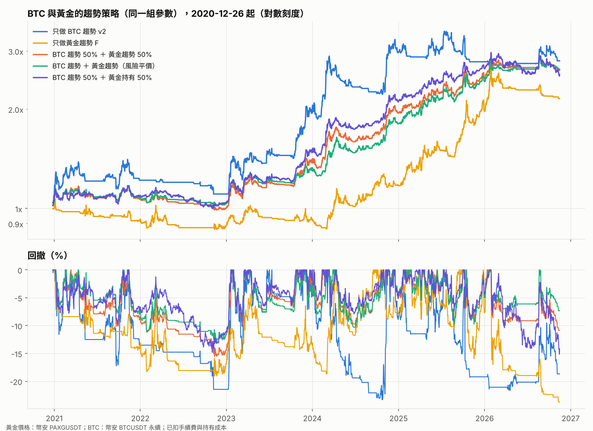

# 黃金：趨勢策略與 BTC 組合

黃金價格用幣安現貨 PAXGUSDT（2020-08-28 ~ 2026-11-16，年化波動 18.7%）。和幣安 XAUUSDT 永續重疊 324 天：日報酬相關 0.991、價差中位數 -0.11%；XAUUSDT 資金費率年化平均 +12.6%（11% 的日子為負）。
趨勢訊號完全沿用 BTC 的 v2 參數（20/60/120 日 × 波動率目標 40%），沒有為黃金調整。

## 1. 黃金的四種做法

| 做法                         | 期間     | 年化     | 波動    |   夏普 | 最大回撤   | 平均曝險   | 成本拖累/年   |
|:---------------------------|:-------|:-------|:------|-----:|:-------|:-------|:---------|
| H 黃金買入持有                   | 全期間    | +12.7% | 18.8% | 0.73 | -31.4% | 1.00x  | +0.0%    |
| H 黃金買入持有                   | 2023 起 | +21.3% | 20.3% | 1.05 | -31.4% | 1.00x  | +0.0%    |
| P 趨勢｜永續（≤1.5 倍，資金費率 12.6%） | 全期間    | +5.7%  | 19.1% | 0.39 | -33.2% | 0.70x  | +11.3%   |
| P 趨勢｜永續（≤1.5 倍，資金費率 12.6%） | 2023 起 | +15.6% | 21.4% | 0.79 | -25.4% | 0.82x  | +12.6%   |
| S 趨勢｜PAXG 現貨（≤1 倍）         | 全期間    | +8.4%  | 13.5% | 0.66 | -19.3% | 0.48x  | +2.8%    |
| S 趨勢｜PAXG 現貨（≤1 倍）         | 2023 起 | +15.9% | 15.3% | 1.04 | -19.3% | 0.56x  | +2.6%    |
| F 趨勢｜期貨（≤1.5 倍，展期 4%）      | 全期間    | +13.9% | 19.1% | 0.78 | -23.7% | 0.70x  | +3.9%    |
| F 趨勢｜期貨（≤1.5 倍，展期 4%）      | 2023 起 | +25.7% | 21.4% | 1.18 | -23.7% | 0.82x  | +4.2%    |

## 2. BTC 趨勢 ＋ 黃金

BTC 趨勢 v2 與黃金趨勢（F）的日報酬相關係數：全部日子 0.02；至少一邊有持倉的日子 0.02（越低分散效果越好）。

| 組合                    | 年化     | 波動    |   夏普 | 最大回撤   |   卡瑪比 |
|:----------------------|:-------|:------|-----:|:-------|------:|
| 只做 BTC 趨勢 v2          | +19.1% | 23.5% | 0.86 | -23.3% |  0.82 |
| 只做黃金趨勢 F              | +13.9% | 19.2% | 0.78 | -23.7% |  0.59 |
| BTC 趨勢 50% ＋ 黃金趨勢 50% | +17.8% | 15.3% | 1.14 | -15.5% |  1.14 |
| BTC 趨勢 ＋ 黃金趨勢（風險平價）   | +17.9% | 14.5% | 1.21 | -12.9% |  1.39 |
| BTC 趨勢 50% ＋ 黃金持有 50% | +17.2% | 15.4% | 1.11 | -15.1% |  1.14 |

各年度：

|   年度 | 只做 BTC 趨勢 v2   | 只做黃金趨勢 F   | BTC 趨勢 50% ＋ 黃金趨勢 50%   | BTC 趨勢 ＋ 黃金趨勢（風險平價）   | BTC 趨勢 50% ＋ 黃金持有 50%   |
|-----:|:---------------|:-----------|:------------------------|:----------------------|:------------------------|
| 2020 | +9.2%          | -0.0%      | +4.5%                   | +4.5%                 | +5.3%                   |
| 2021 | +11.5%         | -7.3%      | +2.6%                   | +4.0%                 | +3.9%                   |
| 2022 | -9.2%          | -4.3%      | -6.5%                   | -4.8%                 | -4.7%                   |
| 2023 | +75.7%         | +4.1%      | +36.9%                  | +25.9%                | +41.6%                  |
| 2024 | +52.7%         | +27.0%     | +41.5%                  | +38.5%                | +42.8%                  |
| 2025 | -6.2%          | +67.9%     | +27.5%                  | +34.4%                | +25.8%                  |
| 2026 | +0.6%          | +9.3%      | +5.7%                   | +9.0%                 | -4.0%                   |

## 限制

- PAXG 是黃金代幣，週末也交易；真正的黃金期貨週末休市、週一可能跳空。
- 永續合約的資金費率只有 XAUUSDT 上市以來（2025-12 起）的數據，用它的平均值套用到整段期間。
- 期貨展期成本用固定 4%／年估計，實際隨美元利率變動（2020–2021 年接近 0%）。
