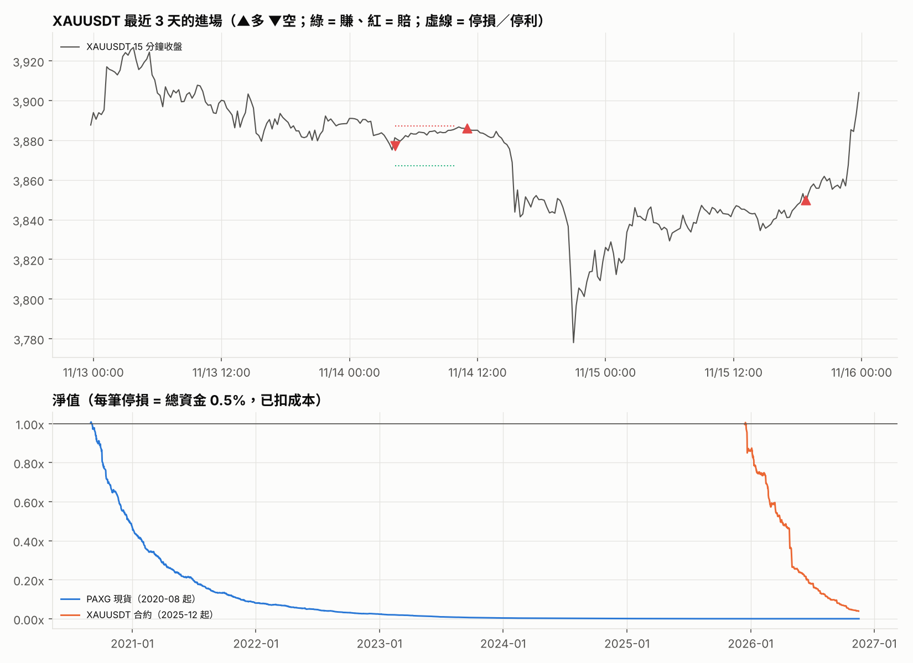

# 黃金日內交易：15 分鐘線「突破後回踩前高／前前高區間」

規則在看結果前寫死：波段點左右各 5 根；區間寬度 0.3～3.0 倍 ATR；限價回踩進場；停損 = 區間另一端 ∓ 0.25 ATR；停利 1:1；最多 32 根（8 小時）。成本：掛單 0.02%、吃單 0.05%＋滑價 0.02%。

## 結果

R = 停損距離。1:1 時，不算成本的損益兩平勝率是 50%；成本佔掉的 R 越多，需要的勝率越高。

| 數據                    | 策略              |   筆數 | 每年筆數   | 勝率    | 停利率   |   每筆期望值（R） | 成本約佔（R）   | 停損距離中位數   | 每筆冒 0.5% 年化   | 最大回撤    |
|:----------------------|:----------------|-----:|:-------|:------|:------|-----------:|:----------|:----------|:--------------|:--------|
| PAXG 現貨（2020-08 起）    | 回踩前高／前前高區間（1:1） | 3533 | 568    | 42.9% | 43%   |     -0.731 | 0.56      | 0.15%     | -87.7%        | -100.0% |
| PAXG 現貨（2020-08 起）    | 只算做多            | 1853 | 298    | 43.1% | 43%   |     -0.751 | 0.59      | 0.15%     | -67.7%        | -99.9%  |
| PAXG 現貨（2020-08 起）    | 只算做空            | 1680 | 270    | 42.6% | 42%   |     -0.709 | 0.53      | 0.15%     | -61.9%        | -99.8%  |
| PAXG 現貨（2020-08 起）    | 對照：隨機進場（10 次平均） | 3220 | —      | 39.5% | —     |     -0.96  | —         | —         | -91.8%        | -100.0% |
| XAUUSDT 合約（2025-12 起） | 回踩前高／前前高區間（1:1） |  554 | 596    | 40.4% | 43%   |     -1.139 | 0.90      | 0.17%     | -96.9%        | -96.1%  |
| XAUUSDT 合約（2025-12 起） | 只算做多            |  277 | 298    | 37.5% | 39%   |     -1.16  | 0.86      | 0.17%     | -82.8%        | -80.5%  |
| XAUUSDT 合約（2025-12 起） | 只算做空            |  277 | 298    | 43.3% | 47%   |     -1.118 | 0.95      | 0.19%     | -82.3%        | -80.1%  |
| XAUUSDT 合約（2025-12 起） | 對照：隨機進場（10 次平均） |  497 | —      | 34.9% | —     |     -1.511 | —         | —         | -98.3%        | -97.8%  |

## 各年度（每筆期望值，R）

|   年度 |   PAXG 現貨 筆數 |   PAXG 現貨 期望值R | XAUUSDT 合約 筆數   | XAUUSDT 合約 期望值R   |
|-----:|-------------:|---------------:|:----------------|:------------------|
| 2020 |          158 |         -0.955 | —               | —                 |
| 2021 |          524 |         -0.668 | —               | —                 |
| 2022 |          555 |         -0.436 | —               | —                 |
| 2023 |          576 |         -0.63  | —               | —                 |
| 2024 |          537 |         -0.54  | —               | —                 |
| 2025 |          641 |         -0.885 | 25.0            | -1.166            |
| 2026 |          542 |         -1.144 | 529.0           | -1.138            |

## 波段點定義的敏感度（事後檢查）

| 數據                    |   波段點左右各幾根 |   筆數 | 勝率    |   每筆期望值（R） |
|:----------------------|-----------:|-----:|:------|-----------:|
| PAXG 現貨（2020-08 起）    |          3 | 4777 | 42.3% |     -0.775 |
| PAXG 現貨（2020-08 起）    |          5 | 3533 | 42.9% |     -0.731 |
| PAXG 現貨（2020-08 起）    |         10 | 2079 | 42.9% |     -0.648 |
| XAUUSDT 合約（2025-12 起） |          3 |  759 | 39.0% |     -1.314 |
| XAUUSDT 合約（2025-12 起） |          5 |  554 | 40.4% |     -1.139 |
| XAUUSDT 合約（2025-12 起） |         10 |  311 | 38.9% |     -1.087 |

## 限制

- 15 分鐘 K 線看不到 K 線內的先後順序；同一根同時碰到停利停損一律算停損（保守）。
- 限價單假設碰到就成交；實際上價格剛好碰到時不一定輪到你，會讓結果偏樂觀。
- PAXG 早期成交量小，15 分鐘的高低點可能和真正的金價不同；XAUUSDT 只有不到一年的數據。
