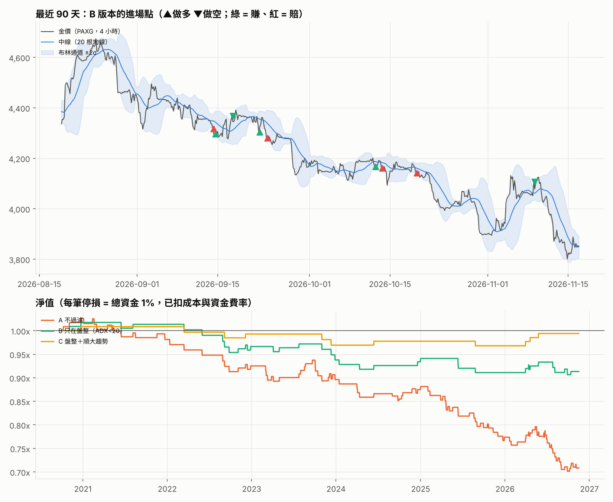

# 黃金：震盪區間均值回歸（布林通道）

幣安 PAXGUSDT 4 小時 K 線 2020-09-30 ~ 2026-11-16。布林通道 20 根 ± 2σ；停損 = 1.5 倍 ATR，停利同距離（損益比 1:1）；最多 30 根（5 天）；來回成本 0.12%＋資金費率；每筆冒總資金 1%。規則在看結果前寫死。

## 結果

R = 停損距離。勝率 = 扣成本後賺錢的比例；停利率 = 碰到停利出場的比例（B' 為中線，其餘為 1:1）。

| 版本                          |   筆數 | 筆數/年   | 停利率   | 勝率   | 平均賺（R）   | 平均賠（R）   |   每筆期望值（R） | 年化（每筆冒 1%）   |    夏普 | 最大回撤   |   最長連虧 |
|:----------------------------|-----:|:-------|:------|:-----|:---------|:---------|-----------:|:-------------|------:|:-------|-------:|
| A 不過濾                       |  880 | 143    | 46%   | 48%  | +0.84    | -1.12    |     -0.187 | -5.5%        | -1.21 | -31.6% |      9 |
| B 只在盤整（ADX<20）              |  310 | 51     | 48%   | 48%  | +0.84    | -1.12    |     -0.173 | -1.5%        | -0.57 | -10.9% |     10 |
| C 盤整＋順大趨勢                   |   92 | 15     | 53%   | 53%  | +0.84    | -1.12    |     -0.073 | -0.1%        | -0.06 | -4.0%  |      6 |
| B' 同 B，但停利在中線（RR 約 0.5～0.8） |  319 | 52     | 48%   | 50%  | +0.72    | -1.11    |     -0.199 | -1.5%        | -0.55 | -13.5% |     17 |
| 對照：隨機進場（20 次平均）             |  396 | —      | 48%   | 50%  | —        | —        |     -0.141 | -1.1%        | -0.35 | -11.5% |      7 |

## 各年度（括號內為筆數）

|   年度 | A 不過濾         | B 只在盤整（ADX<20）   | C 盤整＋順大趨勢   |
|-----:|:--------------|:-----------------|:------------|
| 2020 | +2.6%（33 筆）   | +1.8%（13 筆）      | +0.9%（2 筆）  |
| 2021 | -4.3%（124 筆）  | -0.4%（47 筆）      | +0.0%（15 筆） |
| 2022 | -5.7%（137 筆）  | -4.7%（69 筆）      | -1.6%（19 筆） |
| 2023 | -3.1%（138 筆）  | -2.9%（46 筆）      | -2.4%（16 筆） |
| 2024 | -2.4%（132 筆）  | -0.4%（56 筆）      | +0.9%（18 筆） |
| 2025 | -11.5%（164 筆） | -2.5%（40 筆）      | -1.0%（10 筆） |
| 2026 | -8.5%（152 筆）  | +0.2%（39 筆）      | +2.7%（12 筆） |

## 限制

- PAXG 週末也交易；黃金期貨週末休市，週一跳空會讓停損成交更差。
- 早期 PAXG 成交量較小，4 小時 K 線的高低點可能比真正的金價更誇張。
- 資金費率用 XAUUSDT 上市以來的平均值（年化 12.6%）套用全期間。
