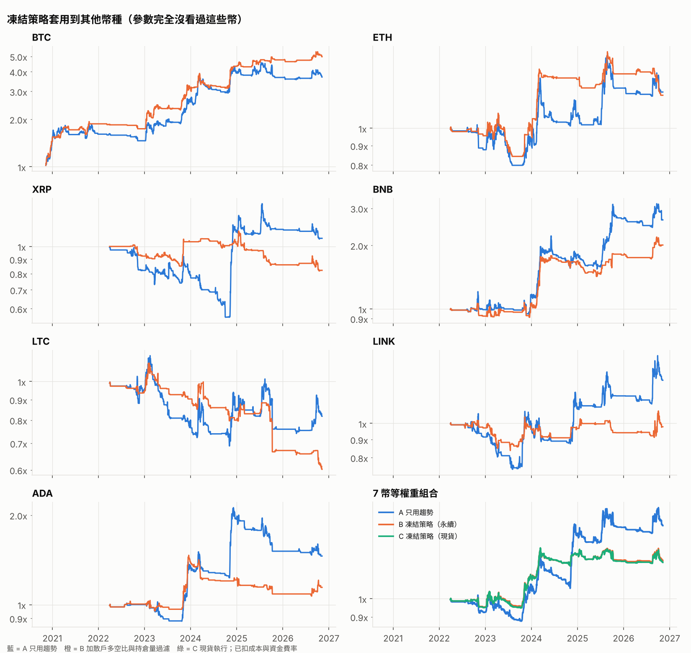

# 多幣種驗證

凍結策略 `v1-2026-11-09` 的參數只在 BTC 上挑過，這裡原封不動套用到其他幣。每個幣從「過濾指標算得出來的第一天」開始比。

- A：只用趨勢（永續）　B：凍結策略（永續）　C：凍結策略（現貨，手續費 12 bps、不付資金費率）
- 「B 勝 A 機率」：20 天區塊重抽 2000 次，B 夏普高於 A 的比例（90% 以上才算可靠）

## 1. 各幣種

| 幣種   | 期間             |   A 夏普 | A 回撤   |   B 夏普 | B 回撤   |   C 夏普 | C 回撤   |   持有 夏普 | 持有 回撤   | B 勝 A 機率   |
|:-----|:---------------|-------:|:-------|-------:|:-------|-------:|:-------|--------:|:--------|:-----------|
| BTC  | 全期間（2020-11 起） |   1.02 | -23%   |   1.47 | -20%   |   1.54 | -19%   |    0.75 | -77%    | 95%        |
| BTC  | 2022-07 起      |   0.91 | -23%   |   1.21 | -20%   |   1.26 | -19%   |    0.88 | -53%    | 87%        |
| ETH  | 全期間（2022-03 起） |   0.32 | -26%   |   0.35 | -23%   |   0.35 | -24%   |    0.19 | -72%    | 53%        |
| ETH  | 2022-07 起      |   0.35 | -26%   |   0.39 | -23%   |   0.39 | -24%   |    0.57 | -68%    | 57%        |
| XRP  | 全期間（2022-03 起） |   0.17 | -44%   |  -0.34 | -28%   |  -0.36 | -28%   |    0.45 | -72%    | 23%        |
| XRP  | 2022-07 起      |   0.21 | -44%   |  -0.35 | -28%   |  -0.37 | -28%   |    0.72 | -72%    | 23%        |
| BNB  | 全期間（2022-03 起） |   0.92 | -30%   |   0.85 | -20%   |   0.72 | -22%   |    0.45 | -58%    | 32%        |
| BNB  | 2022-07 起      |   0.95 | -30%   |   0.89 | -20%   |   0.76 | -22%   |    0.76 | -58%    | 36%        |
| LTC  | 全期間（2022-03 起） |  -0.08 | -41%   |  -0.67 | -46%   |  -0.66 | -46%   |    0.08 | -70%    | 4%         |
| LTC  | 2022-07 起      |  -0.05 | -41%   |  -0.65 | -46%   |  -0.64 | -46%   |    0.33 | -70%    | 4%         |
| LINK | 全期間（2022-03 起） |   0.38 | -30%   |   0.02 | -18%   |   0.02 | -18%   |    0.3  | -75%    | 19%        |
| LINK | 2022-07 起      |   0.4  | -30%   |   0.04 | -18%   |   0.04 | -18%   |    0.55 | -75%    | 20%        |
| ADA  | 全期間（2022-03 起） |   0.52 | -31%   |   0.31 | -27%   |   0.32 | -27%   |   -0.05 | -88%    | 38%        |
| ADA  | 2022-07 起      |   0.56 | -31%   |   0.35 | -27%   |   0.36 | -27%   |    0.15 | -88%    | 37%        |

## 2. 等權重投資組合（2022-03-31 起，所有幣都有數據）

| 組合                | 期間        | 年化報酬   |   夏普值 | 最大回撤   | 平均曝險   |
|:------------------|:----------|:-------|------:|:-------|:-------|
| 7 幣等權重｜A 只用趨勢     | 全期間       | +9.6%  |  0.65 | -20.0% | 0.21x  |
| 7 幣等權重｜A 只用趨勢     | 2022-07 起 | +10.7% |  0.7  | -20.0% | 0.22x  |
| 7 幣等權重｜B 凍結策略（永續） | 全期間       | +4.9%  |  0.57 | -9.8%  | 0.12x  |
| 7 幣等權重｜B 凍結策略（永續） | 2022-07 起 | +5.5%  |  0.62 | -9.8%  | 0.12x  |
| 7 幣等權重｜C 凍結策略（現貨） | 全期間       | +4.7%  |  0.54 | -9.9%  | 0.12x  |
| 7 幣等權重｜C 凍結策略（現貨） | 2022-07 起 | +5.3%  |  0.59 | -9.9%  | 0.12x  |
| 7 幣等權重｜現貨買入持有     | 全期間       | -0.9%  |  0.29 | -65.9% | 1.00x  |
| 7 幣等權重｜現貨買入持有     | 2022-07 起 | +22.0% |  0.63 | -65.9% | 1.00x  |
| 只有 BTC｜A 只用趨勢     | 全期間       | +19.6% |  0.87 | -23.3% | 0.35x  |
| 只有 BTC｜A 只用趨勢     | 2022-07 起 | +21.4% |  0.91 | -23.3% | 0.37x  |
| 只有 BTC｜B 凍結策略（永續） | 全期間       | +23.8% |  1.17 | -19.6% | 0.22x  |
| 只有 BTC｜B 凍結策略（永續） | 2022-07 起 | +25.6% |  1.21 | -19.6% | 0.23x  |

## 3. B 策略各幣報酬的相關係數（平均 0.25，越低分散效果越好）

|      |   BTC |   ETH |   XRP |   BNB |   LTC |   LINK |   ADA |
|:-----|------:|------:|------:|------:|------:|-------:|------:|
| BTC  |  1    |  0.4  |  0.17 |  0.35 |  0.24 |   0.29 |  0.32 |
| ETH  |  0.4  |  1    |  0.17 |  0.26 |  0.25 |   0.17 |  0.22 |
| XRP  |  0.17 |  0.17 |  1    |  0.21 |  0.18 |   0.22 |  0.24 |
| BNB  |  0.35 |  0.26 |  0.21 |  1    |  0.23 |   0.21 |  0.26 |
| LTC  |  0.24 |  0.25 |  0.18 |  0.23 |  1    |   0.22 |  0.35 |
| LINK |  0.29 |  0.17 |  0.22 |  0.21 |  0.22 |   1    |  0.26 |
| ADA  |  0.32 |  0.22 |  0.24 |  0.26 |  0.35 |   0.26 |  1    |

## 4. 指標分 5 組後，之後 7 天平均報酬（Q5 = 指標最高的 20%）

如果「指標越高、之後越差」在多數幣種都成立，過濾條件才比較可信。

| 指標      | 幣種   | Q1    | Q2    | Q3    | Q4    | Q5    |
|:--------|:-----|:------|:------|:------|:------|:------|
| 持倉量水位 z | ADA  | -0.2% | -0.8% | -2.4% | +0.6% | +2.6% |
| 持倉量水位 z | BNB  | +1.2% | +0.5% | +0.3% | +1.3% | -0.8% |
| 持倉量水位 z | BTC  | +1.4% | +2.7% | +1.2% | -0.4% | -0.8% |
| 持倉量水位 z | ETH  | -0.5% | -1.1% | +0.5% | +0.9% | +1.8% |
| 持倉量水位 z | LINK | +1.3% | -1.4% | -0.1% | +1.6% | +0.8% |
| 持倉量水位 z | LTC  | -0.1% | -0.3% | +0.4% | +0.7% | -0.3% |
| 持倉量水位 z | XRP  | +0.4% | -0.9% | -0.0% | +1.3% | +3.2% |
| 散戶多空比 z | ADA  | +1.3% | +0.2% | +1.2% | -0.4% | -2.6% |
| 散戶多空比 z | BNB  | +0.0% | +1.3% | -0.2% | +1.2% | -0.1% |
| 散戶多空比 z | BTC  | +1.3% | +1.3% | +1.0% | +0.6% | +0.0% |
| 散戶多空比 z | ETH  | +1.9% | +0.5% | -0.7% | +0.4% | -0.8% |
| 散戶多空比 z | LINK | +0.6% | +0.5% | +1.3% | -0.9% | +0.5% |
| 散戶多空比 z | LTC  | -0.4% | -0.2% | +0.0% | +1.8% | -0.9% |
| 散戶多空比 z | XRP  | +1.7% | +1.5% | +0.3% | +0.3% | +0.2% |

## 5. 事後檢查：兩個過濾條件拆開（夏普值，各幣從過濾指標可用起）

注意：這是看過上面結果後才做的測試，屬於事後挑選，只能當參考，不能當成新的驗證。

| 幣種    |   A 只用趨勢 |   B 雙過濾 |   D 只用散戶多空比 |   E 只用持倉量水位 |
|:------|---------:|--------:|------------:|------------:|
| BTC   |     1.02 |    1.47 |        1.3  |        1.34 |
| ETH   |     0.32 |    0.35 |        0.27 |        0.39 |
| XRP   |     0.17 |   -0.34 |        0.12 |       -0.33 |
| BNB   |     0.92 |    0.85 |        0.98 |        0.71 |
| LTC   |    -0.08 |   -0.67 |       -0.41 |       -0.42 |
| LINK  |     0.38 |    0.02 |        0.43 |       -0.26 |
| ADA   |     0.52 |    0.31 |        0.5  |        0.21 |
| 7 幣組合 |     0.65 |    0.57 |        0.69 |        0.42 |
