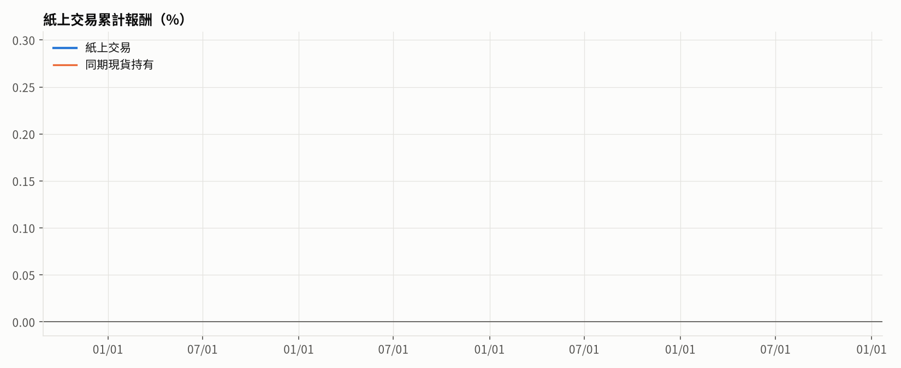

# BTC 紙上交易 v2（歷史檔模式，延遲約 1 天）

策略版本 `v2-2026-11-10`：只用趨勢（20/60/120 日）× 波動率目標 40%（上限 1.5 倍），不加過濾條件。參數已凍結，紙上交易期間不再調整。

## 目前建議

- **建議倉位：空手（0）**（以總資金為 1；1 倍 = 全部資金買 BTC）
- 訊號日：2026-11-12（UTC 收盤），產生於 2026-11-13 19:40 UTC
- 收盤價 71,423，趨勢分數 -0.33，波動率倍數 1.12
- 散戶多空比 z = 2.57，持倉量水位 z = 0.14
- 空手原因：趨勢分數 ≤ 0（不做多）
- 數據來源：幣安歷史檔（延遲約 1 天）

## 下單指示

- 應持有倉位：**空手**（紙上交易開始以來尚未建倉）
- 執行原則（見 docs/entry/）：收盤後立刻市價成交；不要掛低價等回檔，歷史上沒成交時追單的損失大於省下的價差

## 紙上交易績效

- 結算到：2026-11-12（2 天）
- 紙上交易累計：+0.00%　同期現貨持有：-3.17%
- 最大回撤：0.00%

## 預期表現（同一套凍結策略的歷史回測）

注意：這兩個過濾條件是看過 2022-07 之後的樣本外結果才挑的，所以「2022-07 起」的數字偏樂觀；紙上交易就是用來檢驗這點。

| 版本                  | 期間        | 年化報酬   |   夏普值 | 最大回撤   | 平均曝險   |
|:--------------------|:----------|:-------|------:|:-------|:-------|
| 凍結策略｜無延遲            | 全期間       | +31.2% |  1.17 | -23.3% | 0.34x  |
| 凍結策略｜無延遲            | 2022-07 起 | +21.4% |  0.91 | -23.3% | 0.37x  |
| 凍結策略｜延遲 1 天（紙上交易實況） | 全期間       | +24.0% |  0.96 | -30.4% | 0.34x  |
| 凍結策略｜延遲 1 天（紙上交易實況） | 2022-07 起 | +15.5% |  0.71 | -30.4% | 0.37x  |
| 對照：只用趨勢｜延遲 1 天      | 全期間       | +24.0% |  0.96 | -30.4% | 0.34x  |
| 對照：只用趨勢｜延遲 1 天      | 2022-07 起 | +15.5% |  0.71 | -30.4% | 0.37x  |

## 最近的訊號紀錄

| 訊號日        | 產生時間 UTC    |       收盤價 |   趨勢分數 |   波動率倍數 |   散戶多空 z |   持倉量 z |   建議倉位 |
|:-----------|:------------|----------:|-------:|--------:|---------:|--------:|-------:|
| 2026-11-12 | 11-13 19:40 | 71423.300 | -0.333 |   1.117 |    2.566 |   0.140 |      0 |
| 2026-11-11 | 11-12 15:12 | 73980.000 | -0.333 |   1.115 |    1.794 |  -0.622 |      0 |
| 2026-11-10 | 11-12 00:42 | 73762.900 | -0.333 |   1.112 |    2.363 |  -0.162 |      0 |
| 2026-11-09 | 11-10 19:43 | 75327.000 | -0.333 |   1.137 |    2.138 |  -0.333 |      0 |
| 2026-11-08 | 11-10 06:00 | 74823.500 | -0.333 |   1.161 |    2.273 |  -0.833 |      0 |
