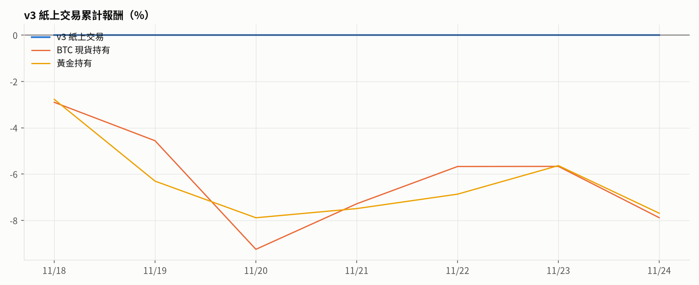

# 紙上交易 v3：BTC 趨勢 ＋ 黃金趨勢（歷史檔模式，延遲約 1 天）

策略版本 `v3-2026-11-17`：BTC 趨勢 ＋ 黃金趨勢（同一組參數：20/60/120 日 × 波動率目標 40%，上限 1.5 倍），依兩條腿過去 180 天的波動做風險平價分配。參數已凍結。
黃金價格用 PAXG；成本照期貨（例如 COMEX 小型黃金）計算。若改用幣安 XAUUSDT 永續，資金費率年化約 12.6%，實際績效會比這裡差。

## 目前建議（以總資金為 1）

- 訊號日：2026-11-24（UTC 收盤），產生於 2026-11-25 08:31 UTC
- **BTC：目標 0.00 倍**（權重 29% × 趨勢倉位 0.00；BTC 趨勢分數 -1.00 ≤ 0，空手）；收盤 59,801
- **黃金：目標 0.00 倍**（權重 71% × 趨勢倉位 0.00；黃金趨勢分數 -1.00 ≤ 0，空手）；收盤 3,547.2
- 目前應持有：BTC 0.00 倍、黃金 0.00 倍（各自套用 0.10 不交易區間）

## 紙上交易績效

- 結算到：2026-11-24（7 天）
- v3 累計：+0.00%（BTC 腿 +0.00%、黃金腿 +0.00%）
- 同期：BTC 現貨 -7.89%、黃金 -7.69%
- 最大回撤：0.00%

## 預期表現（同一套凍結規則的歷史回測）

| 版本             | 年化     |   夏普 | 最大回撤   | 平均總曝險   |
|:---------------|:-------|-----:|:-------|:--------|
| 無延遲            | +15.5% | 1.06 | -15.0% | 0.53x   |
| 延遲 1 天（紙上交易實況） | +13.0% | 0.92 | -18.1% | 0.53x   |

## 最近的訊號紀錄

| 訊號日        |   BTC 趨勢 |   BTC 權重 |   BTC 目標 |   黃金趨勢 |   黃金權重 |   黃金目標 |
|:-----------|---------:|---------:|---------:|-------:|-------:|-------:|
| 2026-11-24 |    -1    |     0.29 |        0 |     -1 |   0.71 |      0 |
| 2026-11-23 |    -1    |     0.29 |        0 |     -1 |   0.71 |      0 |
| 2026-11-22 |    -1    |     0.29 |        0 |     -1 |   0.71 |      0 |
| 2026-11-21 |    -1    |     0.29 |        0 |     -1 |   0.71 |      0 |
| 2026-11-20 |    -1    |     0.29 |        0 |     -1 |   0.71 |      0 |
| 2026-11-19 |    -1    |     0.29 |        0 |     -1 |   0.71 |      0 |
| 2026-11-18 |    -1    |     0.29 |        0 |     -1 |   0.71 |      0 |
| 2026-11-17 |    -1    |     0.29 |        0 |     -1 |   0.71 |      0 |
| 2026-11-16 |    -0.33 |     0.29 |        0 |     -1 |   0.71 |      0 |
| 2026-11-15 |    -0.33 |     0.29 |        0 |     -1 |   0.71 |      0 |
