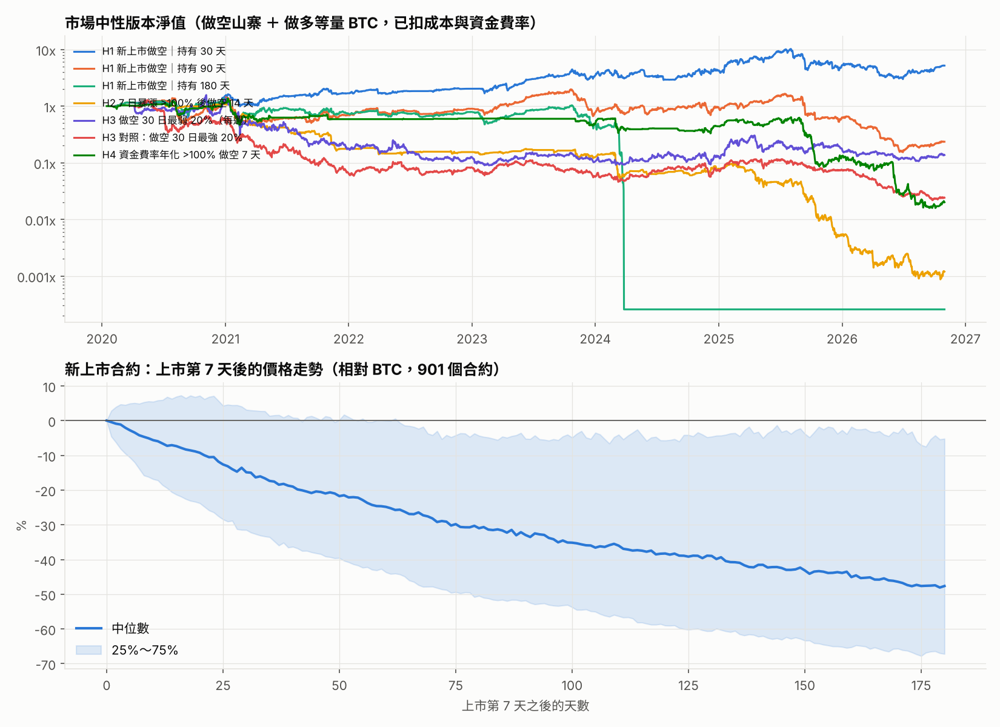

# 山寨幣做空策略研究

宇宙：幣安 921 個 USDT 永續合約（含 34 個已下架），2020-01 ~ 2026-10。
規則：近 30 天成交額 ≥ 5M 美元才交易；進出各 20 bps；資金費率照實計；1 倍保證金，最高價 ≥ 進場價 × 1.9 視為爆倉（虧 100%）。
假設在看結果前就寫死，沒有調參數。

- 「年化／夏普／最大回撤」：單純做空的版本（含大盤方向）
- 「中性」：同時做多等量 BTC，扣掉大盤漲跌後的純選幣能力

## 結果

| 策略                      | 期間        | 年化    |    夏普 | 最大回撤   | 中性 年化   |   中性 夏普 | 中性 回撤   |   筆數/年 | 勝率   | 單筆平均   | 單筆中位數   | 爆倉比例   | 平均空單曝險   |
|:------------------------|:----------|:------|------:|:-------|:--------|--------:|:--------|-------:|:-----|:-------|:--------|:-------|:---------|
| H1 新上市做空｜持有 30 天        | 2020-02 起 | -3%   |  0.25 | -79%   | +28%    |    0.74 | -71%    |     70 | 66%  | +2%    | +15%    | 13.4%  | 0.47x    |
| H1 新上市做空｜持有 90 天        | 2020-02 起 | -43%  | -0.51 | -99%   | -19%    |   -0.12 | -92%    |     36 | 58%  | -9%    | +21%    | 31.6%  | 0.60x    |
| H1 新上市做空｜持有 180 天       | 2020-02 起 | -100% | -1.03 | -100%  | -71%    |   -0.77 | -100%   |     13 | 49%  | -20%   | -5%     | 41.4%  | 0.37x    |
| H2 7 日暴漲 >100% 後做空 14 天 | 2020-07 起 | -69%  | -1.37 | -100%  | -66%    |   -1.29 | -100%   |    101 | 56%  | -10%   | +9%     | 24.9%  | 0.28x    |
| H3 做空 30 日最弱 20%（每週）    | 2020-04 起 | -64%  | -0.63 | -100%  | -26%    |   -0.13 | -94%    |   1894 | 54%  | -0%    | +1%     | 1.1%   | 1.01x    |
| H3 對照：做空 30 日最強 20%     | 2020-04 起 | -72%  | -1.07 | -100%  | -43%    |   -0.62 | -98%    |   1894 | 55%  | -1%    | +2%     | 2.4%   | 1.01x    |
| H4 資金費率年化 >100% 做空 7 天  | 2020-01 起 | -51%  | -0.83 | -99%   | -44%    |   -0.73 | -99%    |    171 | 56%  | -3%    | +3%     | 7.6%   | 0.31x    |

## 各年度（市場中性）

|   年度（市場中性） | H1 新上市做空｜持有 30 天   | H1 新上市做空｜持有 90 天   | H1 新上市做空｜持有 180 天   | H2 7 日暴漲 >100% 後做空 14 天   | H3 做空 30 日最弱 20%（每週）   | H3 對照：做空 30 日最強 20%   | H4 資金費率年化 >100% 做空 7 天   |
|-----------:|:-------------------|:-------------------|:--------------------|:--------------------------|:-----------------------|:----------------------|:-------------------------|
|       2020 | +50%               | +32%               | +30%                | +7%                       | +23%                   | -42%                  | +14%                     |
|       2021 | +12%               | -48%               | -43%                | -84%                      | -85%                   | -89%                  | -49%                     |
|       2022 | +20%               | +30%               | +7%                 | -12%                      | -30%                   | +26%                  | +2%                      |
|       2023 | +70%               | -15%               | -39%                | -19%                      | -17%                   | -30%                  | -18%                     |
|       2024 | +23%               | +25%               | -100%               | -38%                      | +25%                   | +31%                  | -10%                     |
|       2025 | +24%               | -34%               | +0%                 | -93%                      | +37%                   | -1%                   | -70%                     |
|       2026 | -1%                | -63%               | +0%                 | -78%                      | -24%                   | -68%                  | -85%                     |

## H1（持有 30 天）參數鄰近測試（事後探索，只能當參考）

看過上面結果後，才針對唯一看起來有效的 H1-30 天做的檢查：數字在鄰近參數間差很多、或最差時點集中在某段期間，都代表要小心。

| 設定                                   | 中性年化   |   中性夏普 | 最大回撤   | 最深回撤時點   | 爆倉比例   |
|:-------------------------------------|:-------|-------:|:-------|:---------|:-------|
| 基準：第 7 天進、持有 30 天、1 倍保證金、20 bps、10 槽 | +28%   |   0.74 | -71%   | 2026-06  | 13%    |
| 第 5 天進場                              | +17%   |   0.56 | -64%   | 2026-06  | 17%    |
| 第 14 天進場                             | +13%   |   0.5  | -69%   | 2026-06  | 14%    |
| 持有 20 天                              | +8%    |   0.41 | -84%   | 2026-06  | 11%    |
| 持有 45 天                              | +1%    |   0.3  | -93%   | 2026-06  | 19%    |
| 持有 60 天                              | +4%    |   0.35 | -76%   | 2021-03  | 22%    |
| 2 倍保證金（本金加倍、約漲 2.8 倍才爆倉）             | +16%   |   0.64 | -39%   | 2026-06  | 5%     |
| 成本 40 bps                            | +25%   |   0.7  | -72%   | 2026-06  | 13%    |
| 5 槽                                  | +21%   |   0.63 | -73%   | 2026-06  | 13%    |
| 20 槽                                 | +22%   |   0.75 | -67%   | 2026-06  | 13%    |

## H1（持有 90 天）最慘的幾筆：做空的尾部風險

| symbol    | entry      | return   | reason   |
|:----------|:-----------|:---------|:---------|
| BANDUSDT  | 2020-08-05 | -100%    | 爆倉       |
| ALGOUSDT  | 2020-06-23 | -100%    | 爆倉       |
| SXPUSDT   | 2020-07-28 | -100%    | 爆倉       |
| KAVAUSDT  | 2020-08-04 | -100%    | 爆倉       |
| LENDUSDT  | 2020-07-30 | -100%    | 爆倉       |
| THETAUSDT | 2020-06-03 | -100%    | 爆倉       |
| AAVEUSDT  | 2020-10-23 | -100%    | 爆倉       |
| NEARUSDT  | 2020-10-22 | -100%    | 爆倉       |
