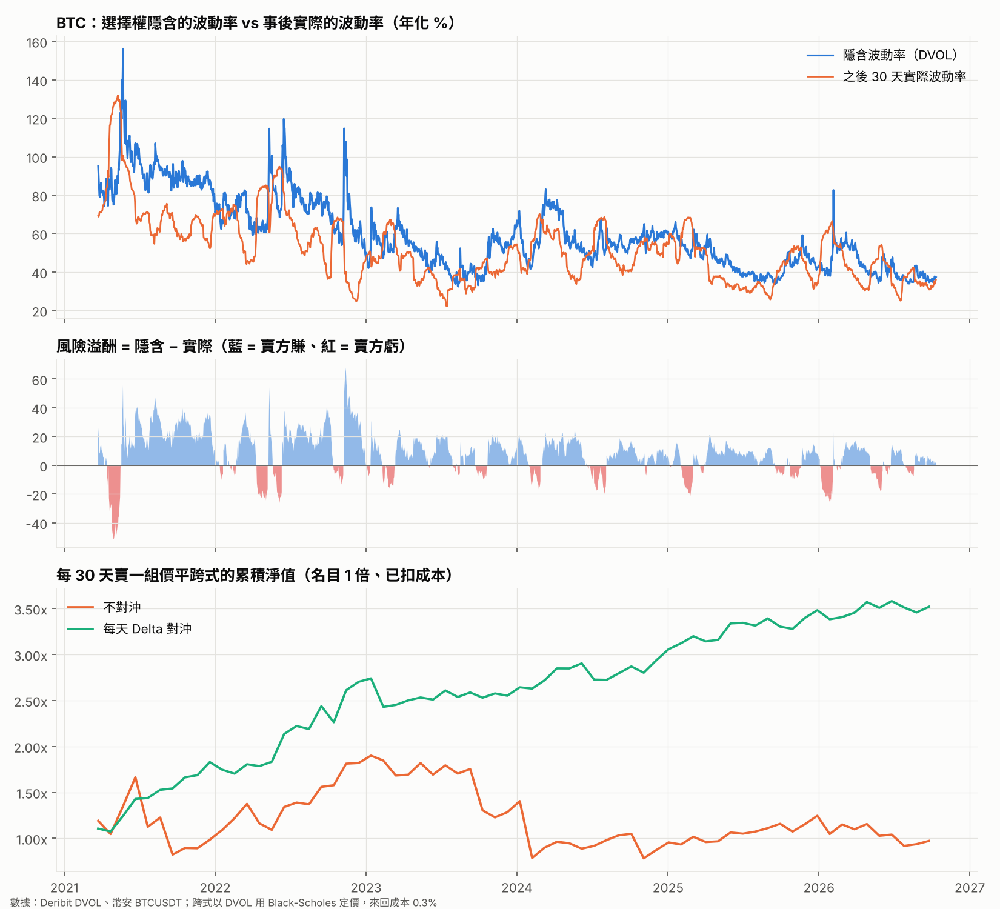

# BTC 波動率風險溢酬

期間：2021-03-24 ~ 2026-10-11（2028 天）。隱含波動率 = Deribit DVOL；實際波動率 = 接下來 30 天每小時報酬年化。

## 1. 隱含 vs 實際（各年度平均）

|   年度（單位：波動率點） |   隱含波動 |   實際波動 |   溢酬 | 溢酬為正的比例   |
|--------------:|-------:|-------:|-----:|:----------|
|          2021 |   91.8 |   75   | 16.7 | 88%       |
|          2022 |   73.6 |   60.6 | 13   | 73%       |
|          2023 |   49.6 |   42.6 |  7.1 | 76%       |
|          2024 |   57.7 |   51.4 |  6.3 | 77%       |
|          2025 |   46   |   42.3 |  3.8 | 71%       |
|          2026 |   42.7 |   41.6 |  1.2 | 61%       |

## 2. 每天賣一組 30 天價平跨式（以名目計、已扣成本）

「年化」是每 30 天賣一組、不重疊；30 種起始日各算一次後取中位數與範圍，看結果對起始日敏不敏感。

| 方式          |   筆數 | 平均     | 中位數    | 勝率   | 最差     | 最好     | 最差 5% 平均   | 年化（中位數）   | 年化範圍            |   夏普（中位數） | 最大回撤（中位數）   | 最大回撤（最差）   |
|:------------|-----:|:-------|:-------|:-----|:-------|:-------|:-----------|:----------|:----------------|----------:|:------------|:-----------|
| 不對沖（收租）     | 2028 | +0.97% | +3.27% | 62%  | -49.7% | +28.9% | -28.2%     | +2.8%     | -2.7% ~ +17.0%  |      0.29 | -53.8%      | -71.5%     |
| 每天 Delta 對沖 | 2028 | +1.73% | +1.68% | 68%  | -16.0% | +20.8% | -6.4%      | +21.9%    | +16.3% ~ +30.1% |      1.47 | -9.6%       | -16.0%     |

成本敏感度：

| 選擇權來回成本   | 不對沖 平均   | 不對沖 年化   | 對沖 平均   | 對沖 年化   |
|:----------|:---------|:---------|:--------|:--------|
| 0.15%     | +1.12%   | +4.7%    | +1.88%  | +24.1%  |
| 0.30%     | +0.97%   | +2.8%    | +1.73%  | +21.9%  |
| 0.60%     | +0.67%   | -0.9%    | +1.43%  | +17.6%  |

逐年（依賣出日分組，每筆是 30 天的報酬）：

|   賣出年度（每筆 30 天） |   筆數 | 不對沖 平均   | 不對沖 勝率   | 對沖 平均   | 對沖 勝率   |
|----------------:|-----:|:---------|:---------|:--------|:--------|
|            2021 |  283 | +2.41%   | 61%      | +3.99%  | 87%     |
|            2022 |  365 | +3.44%   | 64%      | +2.88%  | 67%     |
|            2023 |  365 | -0.61%   | 56%      | +0.92%  | 65%     |
|            2024 |  366 | -0.51%   | 67%      | +1.32%  | 69%     |
|            2025 |  365 | +2.24%   | 65%      | +0.99%  | 65%     |
|            2026 |  284 | -1.32%   | 55%      | +0.52%  | 59%     |

價平修正：DVOL 包含偏斜，通常比價平隱含波動率高；把它往下調幾點，看溢酬還剩多少：

| 隱含波動率     | 對沖 平均（全期）   | 對沖 年化（全期）   | 對沖 平均（2025 起）   | 不對沖 平均（2025 起）   |
|:----------|:------------|:------------|:----------------|:-----------------|
| DVOL      | +1.73%      | +21.9%      | +0.78%          | +0.68%           |
| DVOL -2 點 | +1.28%      | +15.6%      | +0.32%          | +0.22%           |
| DVOL -4 點 | +0.83%      | +9.6%       | -0.15%          | -0.23%           |

## 3. 什麼時候賣比較好？（只用當天已知的資訊判斷）

| 賣出時機                  |   天數 |   隱含波動（平均） |   之後實際波動 | 不對沖 平均   | 不對沖 勝率   | 不對沖 最差   | 對沖 平均   | 對沖 最差   |
|:----------------------|-----:|-----------:|---------:|:---------|:---------|:---------|:--------|:--------|
| 全部日子                  | 2028 |         60 |       52 | +0.97%   | 62%      | -49.7%   | +1.73%  | -16.0%  |
| DVOL 在歷史前 20% 高       |   24 |        103 |       65 | +13.10%  | 88%      | -6.1%    | +11.71% | -2.3%   |
| DVOL 在歷史後 20% 低       | 1031 |         49 |       45 | -1.29%   | 53%      | -49.7%   | +0.35%  | -16.0%  |
| 恐慌：DVOL 7 天內上升 > 15 點 |   51 |         93 |       72 | +11.83%  | 88%      | -8.6%    | +6.90%  | -8.0%   |
| BTC 7 天跌 > 15% 之後     |   46 |         96 |       78 | +12.33%  | 87%      | -12.1%   | +6.98%  | -8.0%   |
| BTC 7 天漲 > 15% 之後     |   70 |         69 |       55 | +2.02%   | 67%      | -34.3%   | +2.54%  | -6.0%   |

「BTC 7 天跌 > 15% 之後賣」拆成獨立事件（樣本很少，結論要保守看）：

| 期間                      |   天數 |   DVOL | 不對沖 平均   | 對沖 平均   |
|:------------------------|-----:|-------:|:---------|:--------|
| 2021-04-22 ~ 2021-04-24 |    3 |     90 | -7.2%    | -2.8%   |
| 2021-05-15 ~ 2021-05-23 |    9 |    125 | +18.1%   | +6.1%   |
| 2021-06-21 ~ 2021-06-22 |    2 |    107 | +22.8%   | +13.7%  |
| 2021-12-09 ~ 2021-12-09 |    1 |     90 | +8.0%    | +7.9%   |
| 2022-01-21 ~ 2022-01-23 |    3 |     79 | +12.2%   | +2.7%   |
| 2022-02-23 ~ 2022-02-23 |    1 |     74 | -2.4%    | -2.4%   |
| 2022-04-11 ~ 2022-04-11 |    1 |     68 | -11.1%   | +1.0%   |
| 2022-05-09 ~ 2022-05-14 |    6 |     96 | +14.9%   | +10.4%  |
| 2022-06-13 ~ 2022-06-19 |    7 |    107 | +15.3%   | +11.5%  |
| 2022-11-09 ~ 2022-11-14 |    5 |    105 | +18.4%   | +18.0%  |
| 2024-08-05 ~ 2024-08-06 |    2 |     62 | +10.1%   | +1.1%   |
| 2026-02-03 ~ 2026-02-06 |    4 |     62 | +7.1%    | -2.2%   |
| 2026-06-05 ~ 2026-06-06 |    2 |     49 | +6.1%    | +3.5%   |

## 4. 最慘的幾筆（不對沖）

| 賣出日        |   當時隱含波動 |   之後實際波動 | BTC 30 天漲跌   | 不對沖    | 對沖    |
|:-----------|---------:|---------:|:-------------|:-------|:------|
| 2024-02-03 |       42 |       47 | +59%         | -49.7% | -0.6% |
| 2024-02-06 |       43 |       56 | +55%         | -45.7% | -0.8% |
| 2024-02-05 |       42 |       56 | +55%         | -45.5% | -0.7% |
| 2024-02-07 |       44 |       56 | +54%         | -44.1% | -0.5% |
| 2024-02-08 |       45 |       56 | +51%         | -41.0% | -0.4% |
| 2024-02-04 |       43 |       53 | +50%         | -40.3% | -0.6% |
| 2024-02-10 |       50 |       57 | +51%         | -40.1% | +0.0% |
| 2024-02-02 |       42 |       46 | +46%         | -36.9% | -0.3% |

## 限制

- DVOL 含價外選擇權的偏斜，通常略高於價平隱含波動率，所以權利金與溢酬可能略為高估。
- 實際賣選擇權需要保證金；不對沖的賣方在急漲急跌時可能被要求追繳或強平，回測以全額擔保計。
- 只用日線模擬對沖；盤中跳空時，實際對沖效果會更差。
